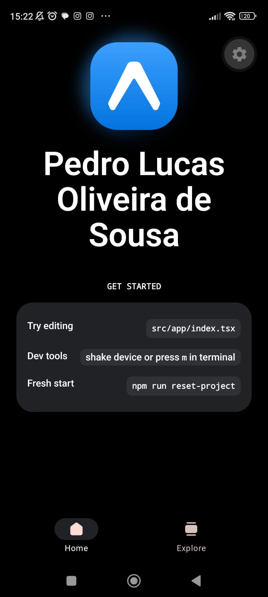

# 2026.3.2 - POS - Frondend mobile

## Informações gerais

- **Público alvo**: alunos da disciplina de **Programação orientada a serviços** do curso de [Infoweb](https://diatinf.ifrn.edu.br/cursos/tecnico-em-informatica-para-internet/) na [DIATINF](https://diatinf.ifrn.edu.br/) no [CNAT-IFRN](https://portal.ifrn.edu.br/campus/natalcentral/)
- **Professor**: [L A Minora](https://github.com/leonardo-minora/)
- **Objetivo**:
  1. Atividade avaliativa para construção de aplicativo com frontend mobile

[A descrição da atividade](atividade.md)

---

## Relato da atividade

Aluno: Pedro Lucas Oliveira de Sousa  
[Github](https://github.com/pdroluc4as)

### Frontend mobile no navegador

### Frontend mobile no celular

---
